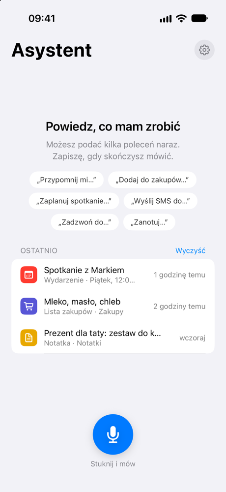
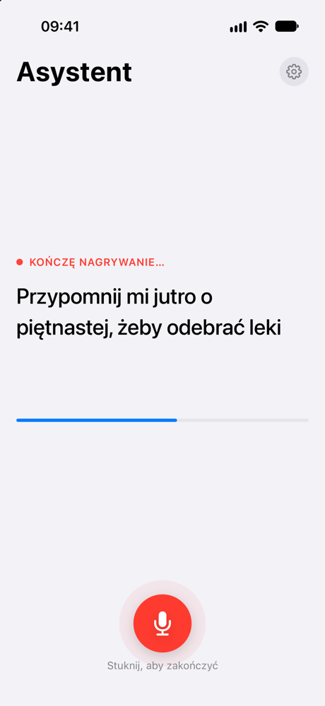
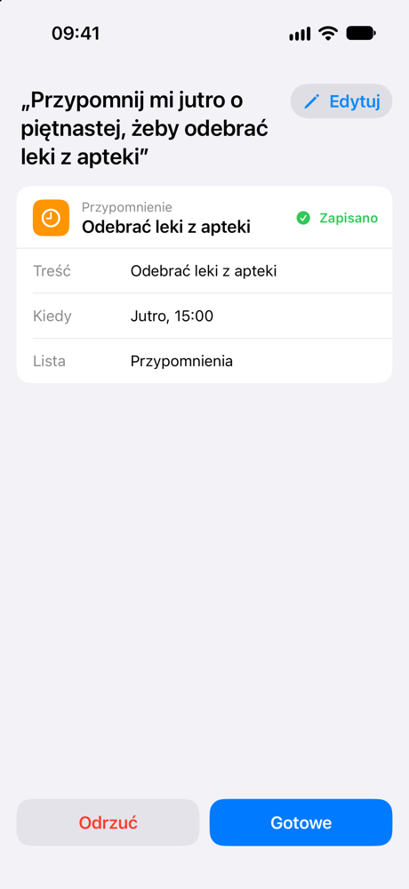
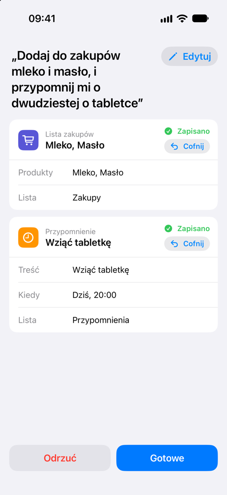
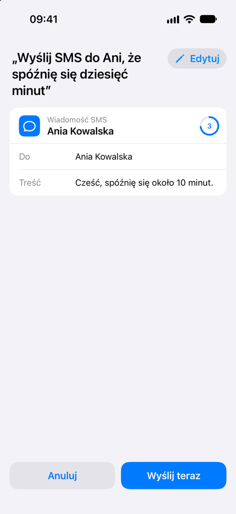
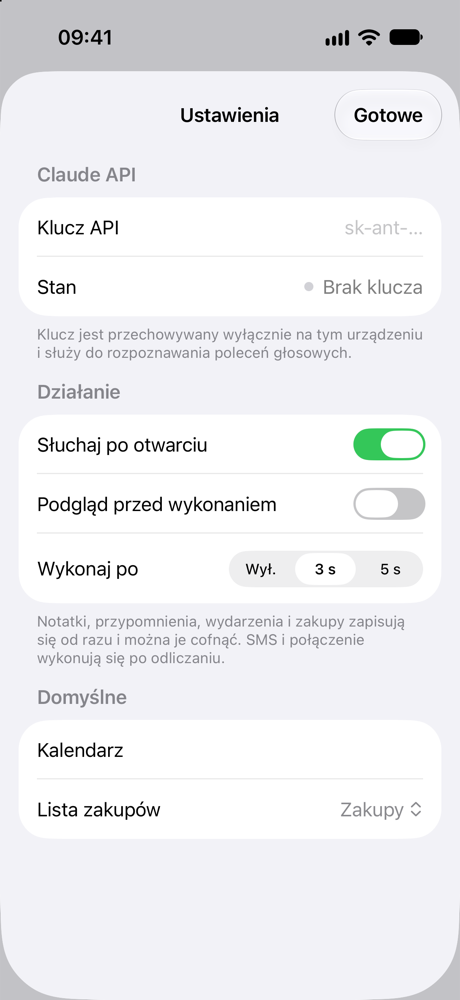
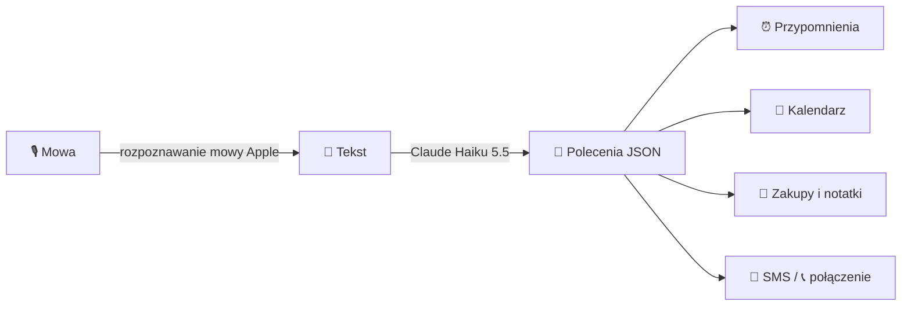

<div align="center">


# Niezapominajka

**Polski asystent głosowy na iPhone'a.** Mówisz, co trzeba zrobić, a on zapisuje przypomnienie, wydarzenie, notatkę albo listę zakupów, wysyła SMS lub dzwoni.

[](https://github.com/mateuszpalak/niezapominajka-ios/actions/workflows/ci.yml)
[](#wymagania)
[](https://swift.org)
[](https://developer.apple.com/xcode/swiftui/)
[](https://www.anthropic.com/claude)
[](LICENSE)

</div>

<table>
  <tr>
    <td align="center" width="33%"><br><sub><b>Start</b> · podpowiedzi i historia „Ostatnio”</sub></td>
    <td align="center" width="33%"><br><sub><b>Nasłuch</b> · kończy się sam po chwili ciszy</sub></td>
    <td align="center" width="33%"><br><sub><b>Zapisane od razu</b> · bez potwierdzania</sub></td>
  </tr>
  <tr>
    <td align="center"><br><sub><b>Kilka poleceń naraz</b> · osobna karta na każde</sub></td>
    <td align="center"><br><sub><b>SMS i połączenie</b> · po odliczaniu albo od razu</sub></td>
    <td align="center"><br><sub><b>Ustawienia</b> · klucz API i sposób działania</sub></td>
  </tr>
</table>

## Co potrafi

| | |
|---|---|
| 🎙️ **Słucha od razu** | Nasłuch startuje po otwarciu aplikacji i kończy się sam po krótkiej ciszy. |
| ⚡ **Zapisuje bez pytania** | Przypomnienia, wydarzenia, notatki i zakupy trafiają od razu do aplikacji Apple. „Odrzuć” lub „Cofnij” je usuwa. |
| ✅ **TickTick** | Opcjonalnie przypomnienia, notatki i zakupy zapisują się w TickTick zamiast w Przypomnieniach. Wydarzenia zostają w Kalendarzu. |
| ⏱️ **SMS i połączenie z odliczaniem** | Zanim wyśle albo zadzwoni, odlicza kilka sekund. Możesz anulować albo wykonać od razu. |
| 🧩 **Kilka poleceń naraz** | „Dodaj mleko do zakupów i przypomnij mi o 20 o tabletce” daje dwie karty. |
| 🙋 **Dopytuje** | Gdy pasuje kilka kontaktów, pyta: „Do której Ani wysłać?”. |
| ✏️ **Edycja polecenia** | Popraw rozpoznany tekst i przeanalizuj go jeszcze raz. |
| 👀 **Tryb podglądu** | Opcjonalnie nic nie zapisuje się bez zatwierdzenia, a pola karty da się edytować. |
| 🔒 **Ekran blokady i Action Button** | Widżet, kontrolka i skrót Siri otwierają aplikację gotową do słuchania. |

## Jak to działa



Aplikacja nie ma własnego serwera. Tekst polecenia trafia prosto do Claude API z twoim kluczem, a wynik zapisuje się w systemowych aplikacjach Przypomnienia i Kalendarz.

## Wymagania

- iPhone z iOS 26 lub nowszym
- Xcode 26 lub nowszy
- [XcodeGen](https://github.com/yonaskolb/XcodeGen) (`brew install xcodegen`)
- Własny klucz Claude API z [platform.claude.com](https://platform.claude.com)

## Uruchomienie

```sh
xcodegen generate
open Reminder.xcodeproj
```

1. W Xcode wybierz swój zespół w *Signing & Capabilities* dla targetów `Reminder` i `ReminderWidget`.
2. Uruchom aplikację na iPhonie.
3. Otwórz Ustawienia (zębatka) i wklej klucz API. Stan „Klucz działa” potwierdzi, że jest poprawny.
4. Opcjonalnie: w sekcji *Zadania* wybierz TickTick i wklej osobisty token API. Utworzysz go w TickTick w przeglądarce: awatar → *Ustawienia → Konto → API Token*. Przypomnienia o miejscu („jak będę w Lidlu”) działają tylko z Przypomnieniami Apple.

Testy:

```sh
xcodebuild test -project Reminder.xcodeproj -scheme Reminder \
  -destination 'platform=iOS Simulator,name=iPhone 17'
```

<details>
<summary>Zrzuty ekranu do README</summary>

Build Debug ma tryb demo, który ustawia aplikację w wybranym stanie bez mikrofonu i bez zapisywania czegokolwiek:

```sh
xcrun simctl launch booted software.plq.niezapominajka -demo multi -AppleLanguages "(pl)"
```

Dostępne stany: `home`, `listening`, `result`, `multi`, `sms`, `settings`.

</details>

## Prywatność

- 🔑 Klucz API i token TickTick są przechowywane tylko w Keychain na urządzeniu.
- 📝 Do Claude API trafia wyłącznie tekst rozpoznanego polecenia, bez nagrania głosu. Mowę na tekst zamienia systemowe rozpoznawanie mowy Apple.
- ✅ Po wybraniu TickTick treść zadań trafia prosto do TickTick Open API.
- 🚫 Brak własnego serwera i analityki.

## Struktura

| Katalog | Zawartość |
|---|---|
| `Reminder/Views` | Ekrany SwiftUI: główny, karta akcji, Ustawienia |
| `Reminder/Services` | Mowa, interpretacja poleceń przez Claude, Przypomnienia / TickTick, Kalendarz, Kontakty, alarmy |
| `Reminder/Models` | Polecenia i historia (SwiftData) |
| `ReminderWidget` | Widżet ekranu blokady i kontrolka |
| `Shared` | Intent wspólny dla aplikacji i widżetu |

## Licencja

[MIT](LICENSE) © 2026 Mateusz Palak
